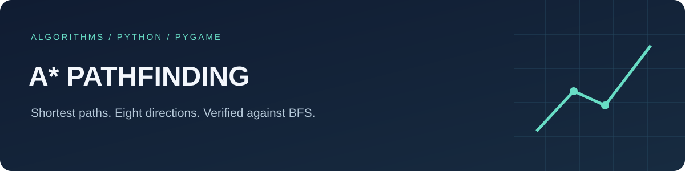

# A* pathfinding visualizer

An interactive Python/Pygame demonstration of shortest-path search on a grid.
Green cells are the search frontier, red cells have been visited, blue cells form the final path, and black cells are obstacles.

## Run

```sh
python -m pip install -r requirements.txt
python main.py
```

The map is generated randomly. Close the window to exit, or click after the search ends.
Change grid and display dimensions in `constants.py`.

## Algorithm

The grid has eight movement directions. Every move costs one, including diagonals.
The search uses Chebyshev distance, which matches this cost model. Diagonal movement between obstacle corners is allowed.
The frontier is a list, so this is a visual learning project rather than a large-map routing engine.

## Validation

```sh
python -m pip install pytest
python -m pytest -q tests
```

Tests compare path length against breadth-first search on 100 fixed rectangular maps, including maps with no route.
The unrelated early CUDA notebook is retained as historical learning material.
